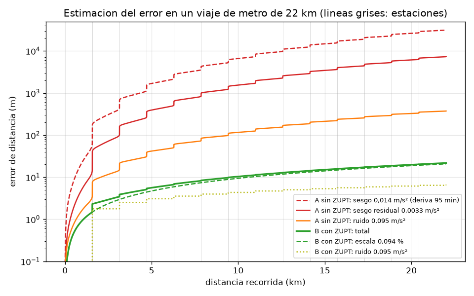

# Guía de estudio del primer parcial

Esta guía es para que **entendamos** el proyecto y lo podamos explicar con nuestras palabras. No son
respuestas para leer de memoria: si una explicación no se entiende, hay que volver al código
(`navegacion.py`, explicado en `EXPLICACION.md`) o a los datos.

Todos los números son nuestros. Al lado de cada uno va de dónde sale, con estas abreviaturas:

| Abreviatura | Archivo |
|---|---|
| [R90] | `resultados/reposo_90min_2026-11-21_1915-2049_reposo.txt` |
| [V90] | `resultados/reposo_90min_2026-11-21_1915-2049_verificar.txt` |
| [R02] | `resultados/sesion_002_reposo.txt` |
| [CAR] | `resultados/caras_2026-11-24_caras.txt` |
| [CV1] | `resultados/caras_2026-11-24v1_caras.txt` |
| [MET] | `resultados/metodos.txt` |
| [ASC] | `resultados/ascensor_2026-11-26_ascensor.txt` |
| [RA] | `RESULTADOS_AVANCE.md` |
| [EST] | `guia/estimar_error_metro.py` (estimación, no medición) |
| [MPU] | InvenSense, *MPU-6500 Product Specification* (tablas del acelerómetro y del giroscopio) |
| [BMP] | Bosch, *BMP280 datasheet* BST-BMP280-DS001 (tabla de sobremuestreo de presión, sección 3.3.1) |
| [FW] | `firmware/registrador_v01/registrador_v01.ino` |

---

## a) Cada figura real: qué muestra, qué señalar, qué concluir

Las figuras están en `resultados/`. Para cada una hay tres preguntas que probablemente haga el
docente, con la idea de la respuesta.

### 1. `sesion_002_senales.png`: primera prueba (21/11, 142 s, sobre una mesa)

- **Qué muestra:** las señales crudas convertidas a unidades: aceleración de los 3 ejes, giroscopio
  de los 3 ejes, presión y temperatura.
- **Qué señalar:** z marca ~10,1 m/s² y no 9,77; los tres giros no están en 0 sino en
  (−4,5; −1,8; −0,2) °/s; la presión tiembla ±5 Pa alrededor de 73 272 Pa; al final (142 s) hay un
  pico porque se movió el dispositivo para apagarlo.
- **Conclusión:** el firmware graba bien (0 perdidas, 200,000 Hz) [R02], pero los sensores tienen
  errores fijos que hay que medir y restar.
- **Preguntas probables:**
  1. *¿Por qué z marca 10,1 si la gravedad en Quito es 9,77?* El acelerómetro tiene sesgo y error
     de escala de fábrica: |a| medio 10,113 m/s², 0,34 m/s² de más [R02]. Con la calibración de
     seis caras da 9,776 m/s² [RA, sección 4].
  2. *¿Por qué el giroscopio no marca cero si está quieto?* Es su sesgo. En x son −4,5 °/s: si no
     se restara, el rumbo giraría 270° en un minuto [R02]. Por eso cada sesión empieza con 10 s quieta.
  3. *¿Por qué la presión es ~733 hPa y no 1013?* Porque Quito está a ~2850 m. A más altura hay
     menos aire encima [RA, sección 4].

### 2. `sesion_002_reposo.png`: detector de quietud en la primera prueba

- **Qué muestra:** |a| y |ω| en el tiempo. Las franjas naranjas son las ventanas de 0,5 s en que el
  detector dijo "en movimiento" (18,0; 76,5; 79,0 y 105,0 s) [R02].
- **Qué señalar:** las franjas coinciden con picos cortos de |a| y |ω|. La línea de 9,77 queda muy
  por debajo de la banda de |a| (sin calibrar).
- **Conclusión:** el detector ve golpes pequeños. Quieto el 98,5 % del tiempo [R02].
- **Preguntas probables:**
  1. *¿Cómo decide si está quieto?* En cada ventana de 0,5 s calcula la desviación estándar de |a| y
     de |ω|. Si las dos están por debajo de 0,06 m/s² y 0,3 °/s, está quieto. Los umbrales están
     por encima del ruido medido (0,013–0,018 m/s² y ~0,06 °/s) [README, parámetros].
  2. *¿Por qué la desviación estándar y no el promedio?* El promedio incluye la gravedad y el sesgo,
     que están siempre. Lo que delata el movimiento es que la señal cambie.
  3. *¿Qué pasa con el ascensor a velocidad constante?* Ahí |a| no cambia y el detector cree que
     está quieto. Por eso usamos el botón para marcar las paradas.

### 3. `reposo_90min_2026-11-21_1915-2049_senales.png`: reposo de 95 min

- **Qué muestra:** las mismas señales durante 94,9 min.
- **Qué señalar:** aceleración y giro planos toda la hora y media; la presión sube ~80 Pa sin que el
  dispositivo se mueva; la temperatura sube de 25,2 a 26,3 °C en ~2 min y baja hasta ~25,1 °C hacia
  el minuto 18–20.
- **Conclusión:** cumple los requisitos del enunciado: ≥ 100 Hz y 90 min sin pérdidas (1 138 860
  muestras, 0 perdidas, 200,000 Hz al inicio y al final) [V90].
- **Preguntas probables:**
  1. *¿Cómo saben que no se perdió ninguna muestra?* El firmware numera cada muestra (`seq`), aunque
     no alcance a escribirla. `verificar` busca saltos en `seq`: no hay ninguno. Además, la
     frecuencia medida al inicio y al final es 200,000 Hz, y el periodo varía solo 0,8 µs [V90].
  2. *¿Por qué sube la presión si no se movió?* Por el clima: +59,5 Pa/h [R90]. Como 1 Pa ≈ 0,12 m,
     eso son ~7 m de altura falsa por hora (9,65 m en los 95 min) [R90]. Por eso se mide la presión
     de referencia P0 al inicio de cada sesión.
  3. *¿Por qué sube la temperatura al inicio?* El dispositivo se calienta solo al encenderse. Se
     estabiliza en ~20 min. En ese tiempo es cuando más cambia el sesgo del giroscopio (figura 5).

### 4. `reposo_90min_2026-11-21_1915-2049_reposo.png`: detector en el reposo largo

- **Qué muestra:** |a| y |ω| durante 95 min, sin ninguna franja naranja.
- **Qué señalar:** el detector dice "quieto" el 100 % del tiempo [R90]. |ω| sube despacio de ~4,8 a
  ~4,9 °/s.
- **Conclusión:** el programa indica correctamente que el dispositivo no se movió (otro requisito
  del enunciado).
- **Preguntas probables:**
  1. *¿Por qué |ω| sube si el dispositivo está quieto?* Porque el sesgo de gx deriva: pasa de −4,452
     a −4,540 °/s [R90]. Al crecer en valor absoluto, |ω| crece.
  2. *¿"100 % quieto" prueba que el detector funciona?* Prueba que no da falsas alarmas. Que sí
     detecta movimiento lo muestran la figura 2 (golpes) y el ascensor.
  3. *¿Por qué |a| está en 10,1 y no en 9,77?* Es el reposo del 21/11, antes de calibrar. Con la
     calibración del 24/11 da 9,755 m/s² [RA, sección 4].

### 5. `reposo_90min_2026-11-21_1915-2049_deriva.png`: deriva por bloques de 10 min

- **Qué muestra:** el promedio de cada bloque de 10 min, restando el del primero: sesgo del
  giroscopio, aceleración, presión y temperatura.
- **Qué señalar:** gx (azul, arriba) cae −0,088 °/s en total; −0,056 de eso en los primeros 20 min,
  mientras cambia la temperatura. La aceleración cambia hasta +0,014 m/s² (ax). La presión sube
  0,80 hPa [R90].
- **Conclusión:** el sensor no es estable: el sesgo medido al inicio no vale para toda la sesión.
- **Preguntas probables:**
  1. *¿Por qué importa una deriva tan pequeña?* Porque se integra. Si solo se resta el sesgo del
     inicio, el que queda crece como k·t (k = −0,047 (°/s)/h) y el rumbo se desvía ½·k·t²: 2,4° en
     10 min y 191° en 90 min [R90].
  2. *¿La deriva es por la temperatura?* En parte: es mayor mientras la temperatura cambia (primeros
     20 min). Pero después la temperatura queda plana y gx sigue bajando ~0,005 °/s cada 10 min, así
     que no es solo eso.
  3. *¿Por qué promediar en bloques?* Para ver un cambio de centésimas por debajo del ruido. Un
     bloque tiene 120 000 muestras. El ruido del promedio es ruido/√N = 0,06/√120 000 ≈ 0,0002 °/s,
     mucho menor que la deriva.

### 6. `caras_2026-11-24_senales.png`: sesión de seis caras (calibración oficial)

- **Qué muestra:** la caja apoyada ~1 min en cada una de sus seis caras y después en 8 posiciones
  inclinadas (desde ~410 s).
- **Qué señalar:** cada cara es un escalón de ~±9,8 m/s² en un solo eje; en las inclinadas, la
  gravedad se reparte entre dos o tres ejes; los picos del giroscopio son los giros de la caja.
  Hay un golpe de ~30 m/s² hacia los 595 s, cerca del límite de ±39 m/s² del rango (±4 g).
- **Conclusión:** con cada eje hacia arriba y hacia abajo se miden su sesgo y su escala.
- **Preguntas probables:**
  1. *¿Por qué cada cara aparece en un solo eje?* Porque quieta, la única aceleración es la gravedad,
     y con una cara abajo cae casi entera en el eje perpendicular.
  2. *¿Por qué no da ±9,77 exacto?* Por el sesgo y la escala del sensor (z+ mide 10,10 y z− −9,65)
     [CAR], y porque las caras quedaron inclinadas 2,8° a 3,7°.
  3. *¿Qué pasa si un golpe pasa de 4 g?* El sensor satura: el valor se queda en el máximo (32 767
     cuentas = 39,2 m/s²) y se pierde información. Para el ascensor y el metro alcanza: el ascensor
     acelera ~1 m/s².

### 7. `caras_2026-11-24_caras.png`: |g| antes y después de calibrar

- **Qué muestra:** |g| en cada tramo quieto. Rojo: sin calibrar; verde: calibrado; línea: 9,77.
- **Qué señalar:** las columnas "extra" (posiciones inclinadas que **no** se usaron para calibrar).
  Sin calibrar van de 9,661 a 10,127 m/s²; calibradas, de 9,770 a 9,799. La desviación estándar entre
  ellas baja de 0,1693 a 0,0092 m/s², 18 veces [CAR].
- **Conclusión:** la calibración funciona en posiciones nuevas: |g| ya no depende de cómo esté la
  caja.
- **Preguntas probables:**
  1. *¿Por qué las caras calibradas no prueban nada?* Porque se calibró con ellas: tienen que dar
     ~9,77 por construcción. La prueba de verdad son los tramos extra.
  2. *¿Por qué los verdes quedan ~0,016 m/s² por encima de 9,77?* Las caras quedaron inclinadas
     ~3,3°. Así el eje principal mide g·cos θ, la escala sale baja y |g| calibrado queda en
     ~9,77/cos θ. Con x+ (3,6°) se predice 9,7893 y se midió 9,7891 [CAR], [RA, sección 3].
  3. *¿Cómo se calculan el sesgo y la escala?* Con el eje arriba se mide a+ = escala·g + sesgo; abajo,
     a− = −escala·g + sesgo. Sumando y restando: sesgo = (a+ + a−)/2 y escala = (a+ − a−)/(2g). En z:
     sesgo +0,224 m/s², escala 1,011 [CAR].

### 8. `caras_2026-11-24v1_senales.png`: segundo intento de seis caras

- **Qué muestra:** solo las seis caras (sin posiciones inclinadas), 8 min.
- **Qué señalar:** los mismos escalones, pero las caras x y z quedaron más inclinadas (3° a 9°).
  Hay 2 tramos extra, que son caras repetidas (z+ y x+), no posiciones nuevas.
- **Conclusión:** sirve para comprobar que la calibración se repite, no para validarla.
- **Preguntas probables:**
  1. *¿Por qué no es la calibración oficial?* Porque sus caras quedaron más inclinadas y no tiene
     posiciones inclinadas para comprobarla.
  2. *¿Por qué la temperatura sube durante toda la sesión?* Se acababa de encender (22,4 → 24,7 °C).
     Es el mismo calentamiento de la figura 3.
  3. *¿Para qué guardarla si no se usa?* Para mostrar que dos calibraciones distintas dan los mismos
     sesgos (figura 9). Es una prueba de que el método es repetible.

### 9. `caras_2026-11-24v1_caras.png`: |g| en el segundo intento

- **Qué muestra:** lo mismo que la figura 7, para v1.
- **Qué señalar:** los verdes quedan más arriba (9,786 a 9,856 m/s²) que en la oficial.
- **Conclusión:** los sesgos coinciden con la oficial (diferencias de 0,003 a 0,022 m/s²). Las
  escalas de x y z salen ~0,5 % más bajas por la inclinación [RA, sección 4].
- **Preguntas probables:**
  1. *¿Se repite la calibración?* Los sesgos sí: z +0,228 contra +0,224; y −0,0145 contra −0,0178
     m/s² [CV1], [CAR].
  2. *¿Por qué cambia la escala?* Por cos θ otra vez. Para x se predice una razón
     cos 7,35°/cos 3,6° = 0,9937, y se mide 0,99268/0,99916 = 0,9935 [RA, sección 4].
  3. *¿Por qué los verdes están más altos que en la oficial?* Caras más inclinadas → escala más
     baja → |g| calibrado más alto (~9,77/cos θ).

### 10. `metodos_convergencia.png`: orden de los métodos de integración

- **Qué muestra:** el error de integrar dos veces una señal con solución exacta
  (a = 0,5·sen(ωt), 0,15 Hz, 30 s), en escala log-log, para varios pasos dt.
- **Qué señalar:** dos rectas. La del trapecio tiene el doble de pendiente que la del rectángulo.
  Al dividir dt a la mitad, el error del rectángulo se divide entre 2 y el del trapecio entre 4
  [MET].
- **Conclusión:** rectángulo es de orden 1 (error ∝ dt) y trapecio de orden 2 (error ∝ dt²), como
  dice la teoría. A 200 Hz el trapecio se equivoca 2,9·10⁻⁵ m en 30 s [MET].
- **Preguntas probables:**
  1. *¿Qué quiere decir "orden 2"?* Que el error es proporcional a dt². En log-log, una recta de
     pendiente 2.
  2. *¿Por qué 0,15 Hz y 30 s (4,5 periodos)?* Si la prueba dura un número entero de periodos, los
     errores del rectángulo se cancelan y parece de orden 2 por casualidad.
  3. *Si el trapecio es mucho mejor, ¿por qué en el ascensor dan casi igual?* Porque el error del
     método es diminuto frente al del sensor: con un sesgo de 0,05 m/s² el sensor aporta 22,5 m en
     30 s y el método 3·10⁻⁵ m, ~10⁶ veces menos [MET]. Ascensor: 0,107 m contra 0,106 m [ASC].

### 11. `ascensor_2026-11-26_senales.png`: señales del ascensor

- **Qué muestra:** las señales crudas de los 13 recorridos (315 s).
- **Qué señalar:** en z, pulsos al arrancar y frenar (no escalones). La presión hace escalones: baja
  al subir, unos 20 Pa por piso de ~2,5 m. Al final, el recorrido 13 queda cortado: la presión sube
  y el registro termina. La temperatura sube 0,9 °C (recién encendido).
- **Conclusión:** los dos sensores ven los 13 recorridos. Hay que cortar en 305 s (`--hasta 305`).
- **Preguntas probables:**
  1. *¿Por qué la aceleración solo tiene pulsos si el ascensor sube varios metros?* La aceleración
     solo aparece al arrancar y al frenar. En el crucero la velocidad es constante (~1,25 m/s) y la
     aceleración es 0. La altura sale de integrar dos veces esos pulsos.
  2. *¿Por qué baja la presión al subir?* Hay menos aire encima. La ecuación hipsométrica da
     h = (R·T/(M·g))·ln(P0/P); en Quito, 1 Pa ≈ 0,12 m.
  3. *¿Qué pasó al final?* Se apagó el dispositivo al llegar del recorrido 13, sin reposo final.
     Sin parada final no hay ZUPT, así que se analiza solo hasta 305 s.

### 12. `ascensor_2026-11-26_ascensor.png`: altura y velocidad (figura principal)

- **Qué muestra:** arriba, la altura según el barómetro (gris), la fusión (naranja) y el
  acelerómetro con ZUPT (azul); líneas punteadas, los pisos de la cinta; puntos negros, los cruces
  de piso (bisección); arriba, el número de cada recorrido (10 y 12 en rojo: no se evalúan). Abajo,
  la velocidad.
- **Qué señalar:** en cada recorrido las tres curvas suben o bajan lo mismo. La velocidad con ZUPT
  vuelve a 0 en cada parada; sin ZUPT (azul de abajo) se va acumulando. Crucero de ±1,25 m/s.
- **Conclusión:** con ZUPT, el acelerómetro mide el desnivel de cada recorrido con un error RMS de
  **0,106 m** en los recorridos que no pasan por PB; sin correcciones, 60 m [ASC], [RA, 5.2].
- **Preguntas probables:**
  1. *¿Qué es el ZUPT y por qué funciona?* En cada parada la velocidad es 0 sí o sí. Al final de un
     recorrido, la velocidad integrada no vuelve a 0: lo que sobra es error acumulado. Se reparte
     como una recta a lo largo del recorrido y se resta. Un sesgo constante se elimina entero.
  2. *¿Por qué el barómetro solo (0,28 m) es peor que el acelerómetro con ZUPT (0,11 m)?* El
     barómetro tiene ruido (0,26 m) y deriva con el clima (~0,7 m en 5 min). En recorridos cortos
     con paradas en medio, el ZUPT corrige mejor. Casi todo el error del barómetro viene del
     recorrido 11, al final de la sesión, cuando ya había derivado [RA, 5.2].
  3. *¿Por qué evalúan el desnivel y descartan el 10 y el 12?* La altura absoluta depende de PB→1,
     que parece mal medida (los sensores dan ~5,3–5,5 m contra 4,90 de la cinta) y no se puede
     volver a medir. En el 10 y el 12 nadie pulsó el botón: los pulsos se inventaron. El criterio se
     decidió por la calidad de los pulsos, antes de ver los errores. Con solo los 6 recorridos de
     pulsos originales el error sale parecido (0,121 m) [RA, 5.1 a 5.4].

### 13. `ascensor_2026-11-26_ascensor_error.png`: error predicho contra observado

- **Qué muestra:** cómo crece el error de altura en el tiempo, sin ZUPT, comparado con la fusión.
  Líneas continuas: observado; punteadas: predicho.
- **Qué señalar:** sin restar el sesgo, el observado sigue la predicción ½·b·t² (503 m predicho
  contra 657 m observado al final). Restando el sesgo, el observado (154 m) queda muy por encima de
  lo que predice el ruido (21 m) [ASC].
- **Conclusión:** el sesgo medido en el reposo inicial no se mantiene toda la sesión. Una diferencia
  de 0,0033 m/s² ya da 154 m en 305 s.
- **Preguntas probables:**
  1. *¿De dónde sale ½·b·t²?* De integrar dos veces una constante: el error de velocidad es b·t y
     el de posición, ½·b·t². Con b = 0,0108 m/s² y t = 305 s: 503 m [ASC].
  2. *¿Por qué el observado no coincide con la predicción por ruido?* La predicción supone que solo
     queda ruido blanco. Pero el sesgo cambia un poco durante la sesión (figura 5), y eso crece como
     t², no como t^1,5.
  3. *¿Entonces la predicción sirve?* Sí, para el orden de magnitud y para saber qué corregir.
     Además, la fórmula del ruido con ZUPT sí acierta: predice 0,100 m de error por recorrido y se
     midieron 0,106 m [EST].

### Extra: `guia/error_metro_estimado.png` (estimación, no son datos)

Está explicada en la sección e).

---

## b) Qué mide cada componente y para qué lo usamos

Detalle técnico y cómo se verificó cada uno: `COMPONENTES.md`.

| Componente | Qué mide o hace | Para qué se usa en el proyecto |
|---|---|---|
| Acelerómetro (MPU-6500) | La aceleración en 3 ejes, **incluida la gravedad**: quieto marca +g hacia arriba | Calibración (seis caras); dirección "arriba" en el reposo inicial; integrar para obtener velocidad y altura (ascensor) o distancia (metro); detector de quietud |
| Giroscopio (MPU-6500) | La velocidad angular en 3 ejes (°/s) | Rumbo del metro (integrando el giro alrededor de la vertical); detector de quietud. Su sesgo (−4,5 °/s en x) se mide en cada reposo inicial |
| Barómetro (BMP280) | La presión del aire (Pa) y la temperatura de su chip (°C) | Altura con la ecuación hipsométrica; fusión con el acelerómetro; comprobar que los dos sensores cuentan la misma historia |
| ESP32 | Lee los sensores cada 5 ms, pone la marca de tiempo y guarda en la microSD | Dos tareas en paralelo (muestreo y escritura) con una cola en medio, para no perder muestras cuando la tarjeta tarda |
| MicroSD | Guarda los archivos de cada sesión | Datos crudos para procesarlos después en Python |
| Botón | Marca un instante en `eventos.csv` | Cierre y apertura de puertas (ascensor), salida y llegada (metro): dice dónde aplicar el ZUPT |
| Power bank | Energía | Grabar sin cables, 95 min sin cortes |
| Caja | Sujeta todo | El sensor tiene que moverse junto con el vehículo; si se mueve dentro de la caja, mide su propio movimiento |

---

## c) De la aceleración a la velocidad y la posición

### Los pasos (ascensor, `comando_ascensor`)

1. **Pasar a m/s²:** `crudo / 8192 · 9,80665`.
2. **Calibrar cada eje:** `a_cal = (a − sesgo) / escala`, con los valores de las seis caras.
3. **Encontrar "arriba":** en el reposo inicial la única aceleración es la gravedad, así que su
   dirección media es la vertical. Así no importa si la caja está inclinada (7,0° en el ascensor
   [ASC]).
4. **Aceleración vertical sin gravedad:** `a_vert = a_cal · arriba − 9,77`.
5. **Restar el sesgo que queda:** en el reposo inicial `a_vert` debería dar 0. Su promedio
   (b = −0,0108 m/s² en el ascensor [ASC]) se resta.
6. **Integrar** (trapecio o rectángulo): aceleración → velocidad.
7. **ZUPT:** en cada parada la velocidad es 0; lo que sobra al final de cada recorrido se reparte
   como una recta y se resta.
8. **Integrar otra vez:** velocidad → altura.

### Por qué el error crece con el tiempo

Cada integración **acumula** los errores: lo que se equivoca la aceleración en cada muestra se va
sumando y nunca se borra.

**Sesgo (error constante b).** Integrar una constante da una recta y volver a integrar da una
parábola:

- error de velocidad = b·t
- error de posición = ½·b·t²

Ejemplos con nuestro sensor:

| Sesgo que queda | De dónde sale | Error en 10 s | En 60 s | En 305 s (sesión del ascensor) |
|---|---|---|---|---|
| 0,34 m/s² (sin calibrar) | \|a\| = 10,11 contra 9,77 [R02] | 17 m | 612 m | 15,8 km |
| 0,029 m/s² (calibrado) | error máximo de la calibración [CAR] | 1,5 m | 52 m | 1,3 km |
| 0,0108 m/s² (calibrado, sin restar el reposo) | sesgo vertical del ascensor [ASC] | 0,54 m | 19 m | 503 m |
| 0,0033 m/s² (restando el reposo inicial) | 154 m en 305 s en el ascensor [ASC] | 0,17 m | 5,9 m | 154 m |

**Ruido blanco (desviación estándar σ por muestra).** Cada muestra trae un error al azar, distinto
cada vez. Al sumar N errores al azar no crecen como N sino como √N (paseo aleatorio). Con
N = t/dt muestras:

- σ_v = σ·√(dt·t) (velocidad)
- σ_x = σ·√dt·t^1,5/√3 (posición, integrando otra vez)

Con dt = 0,005 s (200 Hz):

| Ruido | De dónde sale | σ_v en 60 s | σ_v en 10 min | σ_x en 60 s | σ_x en 305 s |
|---|---|---|---|---|---|
| 0,013 m/s² (sobre la mesa) | [R90] | 0,0071 m/s | 0,0225 m/s | 0,25 m | 2,8 m |
| 0,095 m/s² (piso del ascensor, que vibra) | [ASC] | 0,052 m/s | 0,165 m/s | 1,8 m | 20,6 m |

El sesgo crece como t² y el ruido como t^1,5: **a la larga gana el sesgo**. Por eso lo más importante
es corregir el sesgo (calibración, reposo inicial, ZUPT), no cambiar de método de integración.

**Con ZUPT** cada recorrido empieza de cero. Un sesgo constante se elimina entero. Del ruido queda,
por recorrido de duración τ:

- σ_x = σ·√dt·τ^1,5/√12

Con σ = 0,095 m/s² y los recorridos sin PB del ascensor (de 11,7 a 16,1 s entre pulsos), predice
**0,100 m**; se midieron **0,106 m** [EST], [ASC]. La fórmula explica lo que vimos.

---

## d) Límites del sistema con nuestra configuración

### Rango y resolución

| Sensor | Configuración | Rango | Resolución (1 LSB) | Ruido medido | Fuente |
|---|---|---|---|---|---|
| Acelerómetro | ±4 g, 8192 LSB/g | ±4 g = ±39,2 m/s² | 9,80665/8192 = **0,0012 m/s²** (0,12 mg) | 0,013 m/s² ≈ 11 LSB | [MPU], [R90] |
| Giroscopio | ±500 °/s, 65,5 LSB/(°/s) | ±500 °/s | 1/65,5 = **0,0153 °/s** | ~0,06 °/s ≈ 4 LSB | [MPU], [R90] |
| Barómetro | presión ×8 | 300 a 1100 hPa | 19 bits: **0,33 Pa** ≈ **4 cm** de altura | 2,2–2,7 Pa ≈ 0,26–0,33 m | [BMP], [ASC], [R02] |
| Temperatura | ×1 | — | 16 bits: 0,005 °C | — | [BMP] |

- La resolución **no** es lo que limita: en los tres sensores el ruido es varias veces 1 LSB.
- Pasar de Pa a altura: dh/dP = R·T/(M·g·P) = 8,314·298/(0,02896·9,77·73 000) ≈ 0,12 m/Pa. Por eso
  0,33 Pa ≈ 4 cm.
- El rango ±4 g alcanza para el ascensor (~1 m/s²) y el metro. Lo único que se acercó al límite fue
  un golpe al apoyar la caja en las seis caras (~30 m/s², figura 6).

### Memoria (microSD), con el tamaño real de nuestros archivos

En la sesión de 95 min (5694,3 s) [V90]:

- `imu.csv`: 56 316 885 bytes → **9890 B/s** (~49 bytes por línea, 200 líneas/s).
- `baro.csv`: 4 416 693 bytes → **776 B/s** (~31 bytes por línea, 25 líneas/s).
- Total: **10 666 B/s ≈ 38,4 MB por hora**. 90 min ocupan ~58 MB.

| Tarjeta | Horas de registro |
|---|---|
| por cada 1 GB libre | 26 h |
| **TODO:** capacidad real de nuestra tarjeta | capacidad en GB × 26 h |

En FAT32 un archivo no puede pasar de 4 GiB: `imu.csv` llegaría ahí en 4 294 967 295 / 9890 ≈
434 000 s ≈ **5 días**. Tampoco limita.

### ¿Qué limita primero un registro de 90 min?

| Posible límite | Cuenta | ¿Limita en 90 min? |
|---|---|---|
| Memoria | 58 MB en 90 min (arriba) | No |
| Marcas de tiempo (`t_us`, 64 bits) | se desborda a los 2⁶³ µs ≈ 292 000 años. Con 32 bits se habría desbordado a los 2³² µs = **71,6 min** | No. Por eso el firmware usa `int64_t` [FW] |
| Contador `seq` (32 bits sin signo) | 2³² muestras / 200 Hz = 21,5 millones de s ≈ 248 días | No |
| Cola del firmware | 2000 muestras = 10 s de margen si la tarjeta se atrasa; 0 perdidas en 95 min [V90] | No |
| Energía | la power bank aguantó 95 min sin cortes; no medimos la corriente ni la capacidad (**TODO**) | No en lo que probamos. Es lo único que no está calculado; con las pilas AA hay que comprobarlo |
| Temperatura | +1,1 °C al encender; se estabiliza en ~20 min [R90] | No detiene el registro, pero cambia el sesgo en los primeros 20 min |
| Deriva de los sensores | giroscopio −0,047 (°/s)/h → 191° de rumbo en 90 min; presión +59,5 Pa/h → 7 m/h de altura falsa; acelerómetro +0,014 m/s² en 95 min [R90] | **Sí, para navegar.** El registro dura 90 min sin problema, pero integrar sin correcciones deja de servir en ~1 min |

**Conclusión:** como registrador, el dispositivo ya cumple los 90 min (probado). Lo que limita es la
**deriva de los sensores** al navegar: sin ZUPT ni barómetro, el error se vuelve inútil en segundos
o minutos. El único límite del registro sin calcular es la energía.

---

## e) Estimación para un viaje completo del Metro de Quito

**Esto es una estimación, no una medición.** El metro todavía no se grabó. La calculamos con
`python guia/estimar_error_metro.py` [EST] y los números medidos.

### Supuestos

- Viaje de ~22 km y ~35 min, con 15 estaciones (14 tramos de ~1,57 km).
- Paradas de **1 min**. Con paradas de 3 min no alcanza: 13 paradas de 3 min ya son 39 min, más que
  el viaje completo. Con 1 min quedan ~94 s de movimiento por tramo y una velocidad máxima de
  ~78 km/h (con una aceleración supuesta de 1 m/s²).
- Ruido de 0,095 m/s², el del ascensor (el tren puede vibrar más; no lo sabemos).
- Sesgo que queda después de restar el del reposo inicial: 0,0033 m/s² (el del ascensor). Peor
  caso: 0,014 m/s² (lo que derivó ax en 95 min de reposo [R90]).
- Error de escala: 0,094 % (la variación de |g| calibrado, 0,0092/9,77 [CAR]).

### Caso A: sin ZUPT (solo se resta el sesgo del reposo inicial)

El error crece con el **tiempo**, también mientras el tren está parado:

| Distancia | Tiempo | Sesgo 0,0033 m/s² | Sesgo 0,014 m/s² | Ruido 0,095 m/s² |
|---|---|---|---|---|
| 1,6 km (1.ª estación) | 1,6 min | 14 m | 62 m | 3,5 m |
| 11 km | 17 min | 1,7 km | 7,4 km | 127 m |
| 22 km (final) | 35 min | **7,3 km** | **31 km** | 374 m |

- **Forma:** como la distancia es más o menos proporcional al tiempo, el error crece como d² (una
  parábola). En la figura, además, da un salto en cada estación: el tren está parado (la distancia
  no cambia) pero el error sigue creciendo.
- El resultado no sirve: el error es del orden de la distancia recorrida.

### Caso B: con ZUPT en cada estación

En cada estación la velocidad vuelve a 0, así que cada tramo empieza de cero:

- un sesgo constante dentro del tramo se elimina entero;
- el ruido deja ~1,8 m por tramo (σ·√dt·τ^1,5/√12, con τ = 94 s). Los tramos son independientes, así
  que se suman como paseo aleatorio: √14 · 1,8 ≈ **6,6 m** al final. Con el ruido de la mesa
  (0,013 m/s²) serían 0,9 m;
- el error de escala **no** lo corrige el ZUPT: 0,094 % de 22 km = **20,7 m**.

| Distancia | Ruido (σ = 0,095) | Escala | Total |
|---|---|---|---|
| 1,6 km | 1,8 m | 1,5 m | 2,3 m |
| 11 km | 4,7 m | 10,4 m | 11,4 m |
| 22 km | 6,6 m | 20,7 m | **21,8 m** |

- **Forma:** el ruido sube a escalones, uno por tramo, y crece como √d. La escala crece en línea
  recta con d. Al final domina la escala.
- Mejora: de ~7 km a ~22 m, unas 300 veces.

En la figura (eje vertical logarítmico): las curvas rojas y naranja son el caso A y suben como
parábolas, con saltos en cada estación; las verdes son el caso B, unas 300 veces más abajo.

### Lo que esto nos dice para el segundo parcial

- **ZUPT en cada estación es obligatorio.** Sin eso no hay resultado.
- Con ZUPT, lo que queda es sobre todo el **error de escala**. Se puede corregir con la distancia
  conocida entre estaciones (`metro` ya calcula un factor de escala por mínimos cuadrados).
- **El rumbo es aparte.** Si solo se resta el sesgo del giroscopio del inicio, su deriva
  (−0,047 (°/s)/h [R90]) desvía el rumbo ½·k·t² ≈ **29°** en 35 min, y la trayectoria del mapa se
  tuerce. Hay que volver a medir el sesgo del giroscopio en cada parada.
- **Pendientes:** si la vía sube o baja, el eje "adelante" mide también g·sen θ (con 4 % de
  pendiente, ~0,39 m/s²). Si la pendiente es constante en el tramo, el ZUPT la quita como si fuera
  un sesgo; si cambia dentro del tramo, no. Para eso está la corrección con el barómetro.
